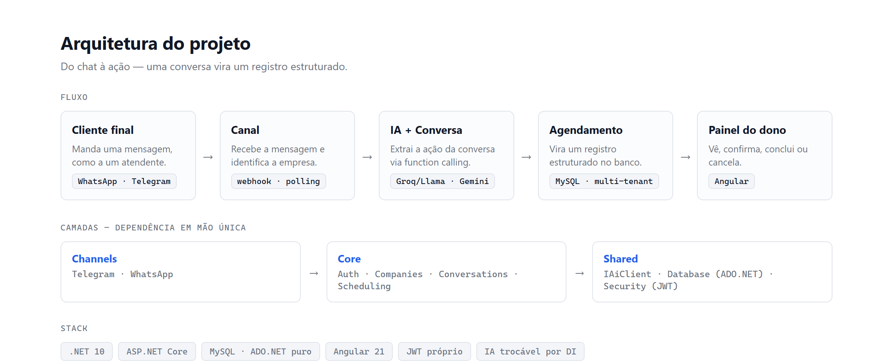
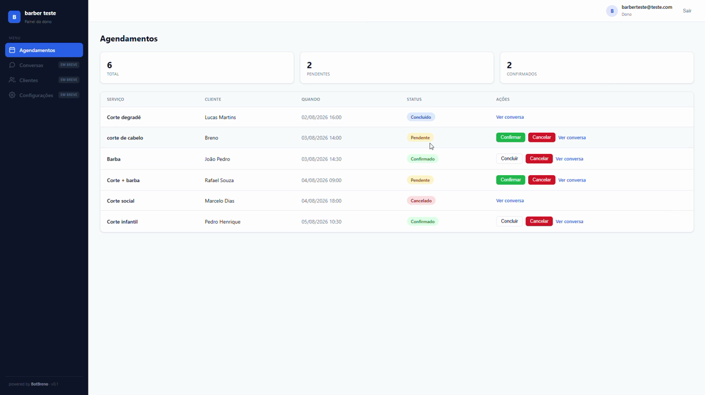

# BotSaaS

Plataforma SaaS de atendimento por IA por chat (WhatsApp/Telegram) para pequenos negócios. O bot é
**transacional**: o cliente final faz um **pedido** ou **marca um horário** pela conversa,
e isso vira um **registro estruturado** que o dono do negócio acompanha num painel.

> Produto SaaS em desenvolvimento — arquitetura limpa e integração de IA ponta a ponta,
> construído incrementalmente, com cada decisão documentada.



O cliente marca um horário conversando naturalmente; a IA extrai a ação e ela vira um agendamento no painel do dono:



## Stack

| Camada | Escolha |
|---|---|
| Backend | C# .NET 10, ASP.NET Core Web API |
| Banco | MySQL |
| Acesso a dados | **ADO.NET puro** (sem ORM/Dapper) + driver MySqlConnector |
| Auth | JWT próprio (HMAC-SHA256) + BCrypt |
| IA | Google Gemini ou Groq/Llama (atrás de interface neutra `IAiClient`, trocável) |
| Canais | Omnichannel Multi-tenant: **Telegram** (Webhooks e Gestão Dinâmica por Empresa via Strategy Pattern) · WhatsApp (planejado) · Instagram (planejado) |
| Frontend | Angular 21 (standalone, signals) — painel do dono |

## Arquitetura

Monólito modular com dependência em mão única:

```
Modules/       → nichos/verticais (ex: Barber): consomem Capabilities + regras próprias
Capabilities/  → ações transacionais reusáveis (Appointments; futuro: Ordering...)
Core/          → kernel universal (Auth, Users, Companies, Conversations, Customers, Channels)
Shared/        → base técnica neutra (Results, Security, Database, AI)

dependência (mão única):  Modules  →  Capabilities  →  Core  →  Shared
```

**Core** = kernel universal da plataforma (Auth, Users, Companies, Conversations, Customers) — o que QUALQUER negócio possui.
**Capability** = capacidades e verticais transacionais reutilizáveis (Appointments, Professionals; futuro: Ordering, Products).
**Module** = um TIPO de negócio (barbearia, clínica), que consome capabilities e pluga regras próprias.

Decisões de design que guiam o código:

- **Separação Core vs Capabilities (`Customer` vs `Professional`)** — `Customer` mora no `Core` porque todo negócio possui clientes (barbearia, delivery, consultório). `Professional` mora em `Capabilities/Professionals` porque é específico da vertical de prestação de serviços e agendamentos (um restaurante ou e-commerce não tem "profissionais" na comanda).

- **Multi-tenant** por `CompanyId`, isolado via JWT nas rotas do dono (o tenant sai sempre do token).
  Num canal (sem JWT), o tenant é resolvido pela identidade do canal.
- **Repositório "burro"** — só executa SQL ou propaga a exceção do driver; tradução de
  erro fica nas camadas de cima (Service → código semântico → Controller → HTTP).
- **Transação explícita** via `DbSession` compartilhado na requisição (registro de
  Company + User é atômico: tudo ou nada).
- **Interfaces neutras** escondem a tecnologia — `IDatabase`, `IPasswordHasher`,
  `IJwtTokenGenerator` e o cliente de IA. Trocar de provedor é trocar uma implementação.
- **Result Pattern** para fluxo de erro sem exceções de controle.

## Funcionalidades atuais

- ✅ Cadastro de empresa + usuário (transacional)
- ✅ Login com verificação BCrypt e emissão de JWT
- ✅ Rota protegida lendo a identidade/tenant das claims do token
- ✅ Integração com IA respondendo via API — dois provedores trocáveis por DI (Gemini e Groq/Llama)
- ✅ Conversas com histórico persistido no banco (memória por cliente) — testado e2e
- ✅ Extração de ação via **function calling** — o modelo extrai um `Agendamento` estruturado da conversa e **grava no banco** (testado e2e)
- ✅ **Conversa multi-turno com tools** — o bot chama uma ferramenta, recebe o resultado e responde com base nele; a confirmação de agendamento é **determinística** (data/hora montadas em código, não pelo modelo), enquanto consultas são fraseadas pelo modelo
- ✅ **Autoatendimento do cliente** — o cliente pergunta pelo chat quais horários tem marcados e o bot responde com os seus agendamentos ativos (`consultar_agendamentos`), testado e2e
- ✅ Visão do dono — `GET /api/appointments` lista os agendamentos da empresa (tenant do JWT), testado e2e
- ✅ **Painel do dono em Angular** — login + grade executiva de cadeiras (horários × profissionais) + alternância para lista cronológica + KPIs operacionais em tempo real + gestão de status (confirmar/concluir/cancelar) + histórico da conversa que gerou cada agendamento + gestão completa da equipe (`/team`) + gestão de horários de funcionamento (`/settings`)
- ✅ **Canal de mensagens real (Telegram)** — bot por *long polling* roteando cada mensagem pelo mesmo `ConversationService` da API; testado e2e (conversa real no Telegram → agendamento no painel)
- ✅ **Regra de disponibilidade (anti-double-booking)** — dois clientes não fecham o mesmo horário; a segunda tentativa é recusada na gravação, testado e2e
- ✅ **Lembrete automático de agendamento** — `ReminderBackgroundService` varre a cada 1 minuto agendamentos nas próximas 2 horas e envia lembrete proativo ao cliente via Telegram; marca `reminded_at` no banco para nunca repetir; índice composto `(reminded_at, scheduled_at, status)` garante performance
- ✅ **Canal de envio neutro (`IMessageSender`)** — contrato em `Core/Channels/Interfaces` implementado por `TelegramMessageSender` (Typed HttpClient via `IHttpClientFactory`) com suporte a disparo multi-tenant via `channelIdentifier`; trocar para WhatsApp = nova implementação, zero mudança no fluxo
- ✅ **Horário de funcionamento básico** — tabela `business_hours` por dia da semana (`opens_at`, `closes_at`, `is_closed`); validação no agendamento bloqueia datas passadas, dias fechados e horários fora de expediente; endpoints REST para consulta e edição + interface visual no painel
- ✅ **Multi-Profissional (Equipe / Profissionais)** — gestão de profissionais por empresa (tabela `professionals`), vinculação obrigatória de profissional a cada agendamento (`professional_id`), disponibilidade anti-concorrência individual (dois profissionais atendem ao mesmo tempo sem conflito), consultas via `INNER JOIN`, e ferramentas da IA (`CreateAppointmentTool` com escolha de profissional e `GetProfessionalsTool` para a IA listar a equipe)
- ✅ **Mini-CRM & Gestão de Clientes (`/customers`)** — tabela `customers` (`company_id`, `phone`, `name`) com isolamento por tenant; reconhecimento de identidade pelo bot no chat; cadastro manual com sanitização e validação estrita de telefone (DDD válido e 10 a 11 dígitos); tela no painel em tabela executiva compacta com busca instantânea, links rápidos para WhatsApp/Telegram e modal de histórico de atendimentos passados e futuros
- ✅ **Ciclo de Vida de Sessões & Expiração por Inatividade (12h)** — gerenciamento de sessões ativas (`is_active`, `closed_at`) na tabela `conversations` com encerramento automático após 12h de inatividade; impede que mensagens antigas poluam o contexto da IA e causem alucinações de datas passadas, preservando a identidade permanente do cliente via tabela `customers`
- ✅ **Agendamento Manual pela Recepção & Modelagem de Origem** — endpoint `POST /api/appointments` (tenant-scoped) permitindo que a recepção crie agendamentos de balcão/telefone; modelagem com `origin` (`Bot` vs `Manual`), `customer_phone` autossuficiente e `conversation_id` opcional, desacoplando agendamentos do chat
- ✅ **Arquitetura Omnichannel (`MessageChannel`)** — suporte nativo a múltiplos canais de chat (WhatsApp, Telegram, Instagram); separação do identificador do canal (`channel_contact_id`) do telefone (`customer_phone`), com índice composto otimizado (`idx_company_channel_contact_active`)
- ✅ **Cadastro Automático de Clientes via Bot & Ciclo de Transações** — persistência automática de novos clientes no Mini-CRM (`customers`) ao concluir agendamento pelo bot; isolamento estrito de transação no `DbSession` após commits/rollbacks
- ✅ **Canais de Atendimento Multi-Tenant (`/channels`) & Webhooks Dinâmicos** — gestão dinâmica de bots por empresa no banco (`channels`); conexão extensível via Strategy Pattern (`IChannelProvider` e `IChannelService`) respeitando o Open-Closed Principle (OCP); resolução automática de tenant pelo `{channelId}` na URL de webhook sem variáveis fixas no `.env`; proteção contra vulnerabilidades de IDOR/BOLA com queries estritas `company_id`.
- ✅ **Hub de Configurações ⚙️ & Refinamento de UX (`/settings`)** — unificação das opções administrativas (Canais de Atendimento, Equipe & Profissionais e Horários de Expediente) em abas fluidas acessíveis via engrenagem no topo direito; barra de navegação principal otimizada para a rotina diária (`Agenda` e `Clientes`); modais dedicados de cadastro/edição com validações e tradução de erros em tempo real.
- ✅ **Script DDL Unificado do Banco de Dados** — arquivo `database/schema.sql` contendo o schema completo e fiel de todas as 9 tabelas e índices do MySQL para provisionamento rápido em qualquer ambiente
- 🔜 Catálogo de serviços com preço e duração, webhook oficial WhatsApp, cobrança via PIX

## Endpoints

| Método | Rota | Descrição |
|---|---|---|
| `POST` | `/api/auth/register` | Cria empresa + usuário |
| `POST` | `/api/auth/login` | Autentica e devolve o JWT + o nome da empresa (white-label) |
| `GET`  | `/api/me` | Identidade do requisitante (requer Bearer) |
| `GET`  | `/api/channels` | Lista os canais de atendimento conectados da empresa (requer Bearer; tenant-scoped) |
| `POST` | `/api/channels` | Conecta um canal (Telegram/WhatsApp) via Strategy Pattern e registra webhook (requer Bearer; tenant-scoped) |
| `DELETE` | `/api/channels/{id}` | Desconecta um canal e remove o webhook no provedor externo (requer Bearer; tenant-scoped) |
| `POST` | `/api/webhooks/telegram/{channelId}` | Endpoint público que recebe mensagens do Telegram, resolve o tenant pelo canal e despacha para a IA |
| `POST` | `/api/conversations` | Processa uma mensagem do cliente e devolve a resposta da IA (requer Bearer; entrada dev/token) |
| `POST` | `/api/appointments` | Cria um agendamento manualmente pela recepção (requer Bearer; tenant-scoped) |
| `GET`  | `/api/appointments` | Lista os agendamentos da empresa do requisitante (requer Bearer; a "visão do dono") |
| `PATCH` | `/api/appointments/{id}/status` | Atualiza o status de um agendamento (requer Bearer; tenant-scoped) |
| `GET`  | `/api/conversations/{id}/messages` | Mensagens de uma conversa (requer Bearer; tenant-scoped) — o chat por trás de um agendamento |
| `GET`  | `/api/business-hours` | Lista os horários de funcionamento da semana da empresa (requer Bearer; tenant-scoped) |
| `PUT`  | `/api/business-hours` | Atualiza a grade semanal de horários de funcionamento (requer Bearer; tenant-scoped) |
| `POST` | `/api/professionals` | Cadastra um novo profissional para a empresa (requer Bearer; tenant-scoped) |
| `GET`  | `/api/professionals` | Lista os profissionais da empresa, opcionalmente filtrando por status (requer Bearer; tenant-scoped) |
| `GET`  | `/api/professionals/{id}` | Detalha um profissional específico por ID (requer Bearer; tenant-scoped) |
| `PUT`  | `/api/professionals/{id}` | Atualiza dados e status de um profissional existente (requer Bearer; tenant-scoped) |
| `POST` | `/api/customers` | Cadastra manualmente um cliente com validação estrita de telefone (requer Bearer; tenant-scoped) |
| `GET`  | `/api/customers` | Lista os clientes da empresa do requisitante (requer Bearer; tenant-scoped) |
| `GET`  | `/api/customers/{id}` | Detalha um cliente específico por ID (requer Bearer; tenant-scoped) |
| `GET`  | `/api/appointments/customer?phone={phone}` | Lista o histórico de agendamentos de um cliente por telefone (requer Bearer; tenant-scoped) |

> No **canal de Telegram**, a entrada em produção ocorre via **Webhook** (`/api/webhooks/telegram/{channelId}`),
> onde cada empresa cadastra seu próprio bot no painel (`/settings`) e o webhook resolve dinamicamente o `companyId`.
> Para desenvolvimento local sem necessidade de túnel público, o `TelegramPollingService` opcional pode ser utilizado como fallback.

## Como rodar

### Opção 1: Via Docker Compose (Recomendado)

**Pré-requisito:** Docker e Docker Compose instalados.

1. Clone o repositório e configure seu arquivo `.env` na raiz.
2. Suba o ecossistema completo (Banco MySQL, Backend .NET e Frontend Angular):
   ```bash
   docker compose up -d
   ```
3. Acessos:
   - **Frontend (Painel do Dono):** `http://localhost:4200`
   - **Backend API:** `http://localhost:5069`
   - **Banco MySQL:** `localhost:3306` (inicializado automaticamente via `database/schema.sql`)

### Opção 2: Localmente

**Pré-requisitos:** SDK do .NET 10, Node.js 20+, MySQL, uma chave de API de IA (Google Gemini ou Groq).

1. Clone o repositório e crie um arquivo `.env` na raiz.
2. Preencha o `.env` com suas variáveis: banco (`DB_HOST/USER/PASSWORD/NAME/PORT`),
   JWT (`JWT_SECRET/ISSUER/AUDIENCE/EXPIRES_HOURS`), IA (`GEMINI_API_KEY/MODEL` e/ou
   `GROQ_API_KEY/MODEL`) e `SYSTEM_PROMPT`. O provedor ativo é escolhido na DI (`Program.cs`).
   - **Canais e Webhooks:** `APP_BASE_URL` (URL pública do backend, ex: `https://meu-saas.com` ou túnel ngrok para registrar os webhooks no Telegram).
   - **Opcional (polling dev legado):** `TELEGRAM_BOT_TOKEN` e `TELEGRAM_TEST_COMPANY_ID` caso utilize o serviço local de polling em vez de webhook.
3. Crie o banco e execute o script unificado `database/schema.sql` no MySQL (ele cria as 9 tabelas e todos os índices necessários).
4. Rode o backend:
   ```bash
   dotnet run
   ```
   A API sobe em `http://localhost:5069`. Se o Telegram estiver configurado, o console mostra `Telegram polling iniciado.`

5. Rode o frontend (painel do dono):
   ```bash
   cd web
   npm install
   ng serve
   ```
   Abre em `http://localhost:4200`. Precisa do backend no ar (CORS já libera `localhost:4200`).

## Estrutura

```
src/
├── Core/             kernel universal
│   ├── Auth/          registro e login (orquestra o cadastro)
│   ├── Users/         entidade User + gestão
│   ├── Companies/     os tenants (empresas clientes) + horários de funcionamento (BusinessHours)
│   ├── Customers/     gestão e persistência de clientes (identidade e telefone)
│   ├── Channels/      gestão de canais multi-tenant (Strategy Pattern, IChannelProvider, IChannelService)
│   │   ├── Interfaces/ contratos de providers, repositório e serviços
│   │   └── Telegram/   adaptadores específicos do Telegram (Provider, WebhookController, Sender, Polling)
│   └── Conversations/ conversa + mensagens + roteador genérico de tools (IChatTool)
├── Capabilities/     ações transacionais reusáveis
│   ├── Appointments/  agendamentos (Appointment + service + repo + Tools/{CreateAppointmentTool,
│   │                  GetAppointmentsTool} + IAvailabilityPolicy/GenericAvailabilityPolicy
│   │                  + ReminderBackgroundService — lembrete proativo)
│   └── Professionals/ equipe/prestadores (Professional + service + repo + controller +
│                      Tools/GetProfessionalsTool)
├── Modules/          nichos/verticais
│   └── Barber/        regras específicas do nicho (futuras policies por segmento)
└── Shared/
    ├── Results/     Result Pattern
    ├── Security/    hash de senha + JWT
    ├── Database/    conexão e sessão de transação
    └── AI/          cliente de IA (Gemini e Groq, atrás de IAiClient)

web/                 painel do dono em Angular (login + agenda + clientes + hub de configurações /settings com canais, equipe e horários)
```
